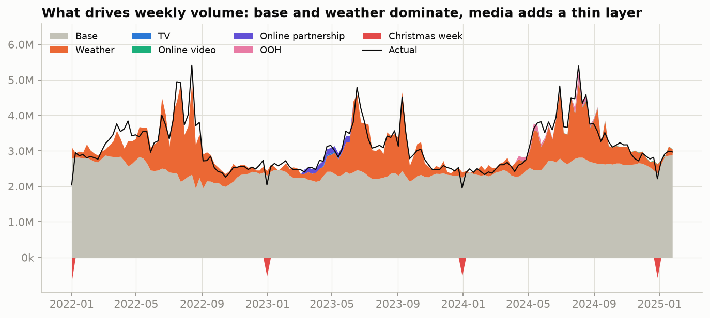
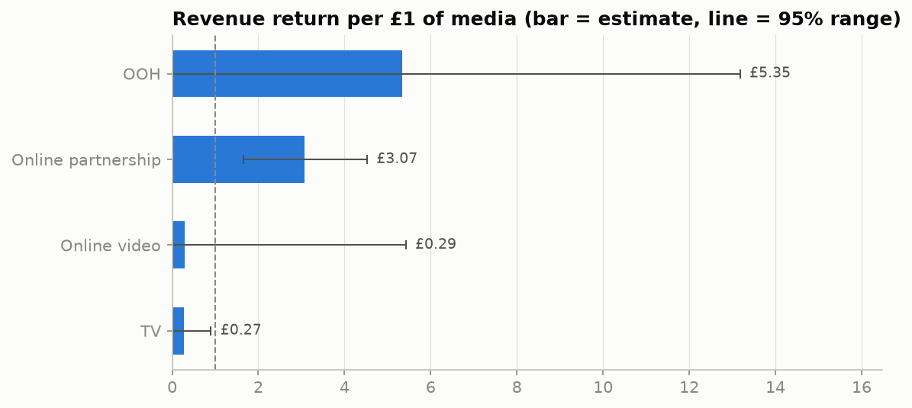
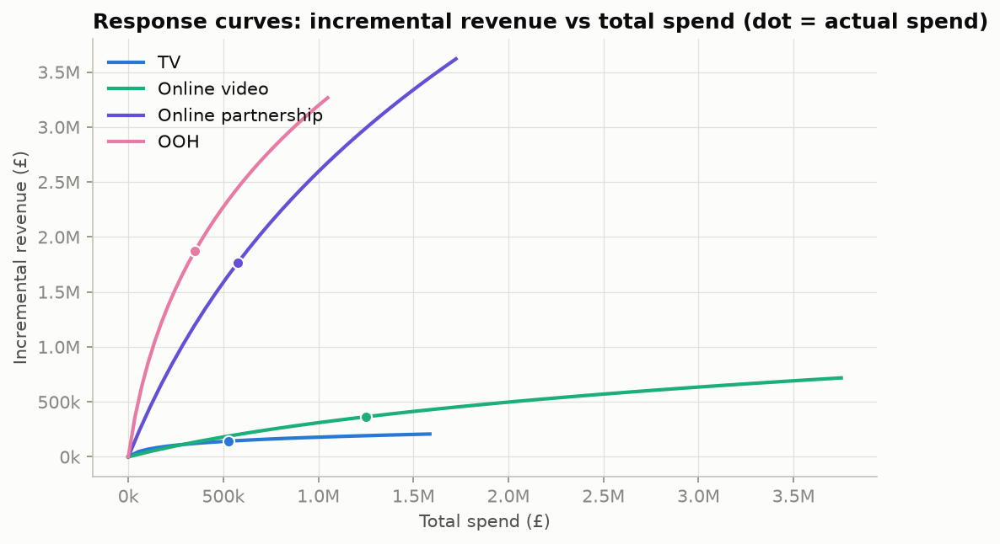
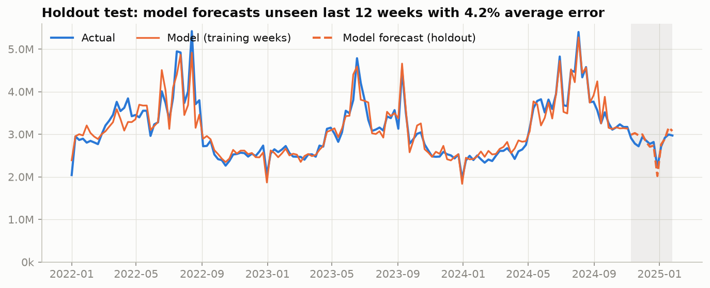

# What drives bottled-water sales, and what is media worth?

A **marketing mix model (MMM)** in Python for an FMCG bottled-water brand. It uses 161 weeks of sales, price,
promotion, distribution, competitor, weather and media data (January 2022 to January 2025) to answer two
questions: how effective is the brand's advertising, and what else drives its sales?

**[Slides (PDF)](MMM_presentation.pdf)** · **[Full analysis notebook](MMM_analysis.ipynb)**
([nbviewer](https://nbviewer.org/github/Yazan-Alrefaai/fmcg-marketing-mix-model/blob/main/MMM_analysis.ipynb))
· **[Decision log](docs/decision_log.md)**



## Key findings

- **Base sales are about 79% of volume, weather about 20%, and media about 1%.**
- **Distribution is the strongest lever the brand controls.** One extra point of weighted distribution
  (ACV) adds 3.7% volume, worth about £6M a year.
- **Price matters relative to competitors.** A 10% higher price than competitors costs 4.3% of volume
  (elasticity −0.46). The brand's premium grew from +46% to +89%, which explains most of the 2023 decline.
- **Online partnership is the only media channel that is both high-return and certain:** £3.07 of revenue per £1.
- **Moving 30% of the TV and online video budget into Online partnership adds about £0.9M** of revenue at the same total spend.
- **About 28% of promoted volume is incremental.** Promotions work by widening store reach, not through discount depth.

| Driver | Effect on weekly volume |
|---|---|
| +1°C max temperature | +1.9% (and +2.2% more per °C above 20°C) |
| +10 mm rain | −1.7% |
| Christmas / New Year week | −22% |
| +10% price vs competitors | −4.3% |
| +1 point weighted distribution | +3.7% |

| Channel | Spend | ROI (revenue per £1) | 95% range | Next £1 returns |
|---|---|---|---|---|
| OOH | £350k | £5.35 | £0.00 – £13.18 | £2.95 |
| Online partnership | £575k | £3.07 | £1.65 – £4.52 | £2.22 |
| Online video | £1,250k | £0.29 | £0.00 – £5.42 | £0.20 |
| TV | £529k | £0.27 | £0.00 – £0.90 | £0.10 |

OOH has the highest point estimate, but it ran for only 5 weeks, so its range starts at zero: promising, not proven.
Social, Search and RDM could not be measured (no positive effect, or too little spend). ROI is revenue-based,
because no margin data was available.

<p>


</p>

## Model quality

| Check | Result |
|---|---|
| Adjusted R² | 0.91 |
| Average weekly error (MAPE) | 4.5% |
| Error on 12 unseen weeks (strict holdout, whole pipeline re-run without them) | 4.2% |
| Multicollinearity | every VIF below 4 |
| Stability | coefficients hold when any one year is left out |



## Approach

1. **Clean and explore.** Data-quality checks, then 10 exploratory charts. Exploration found traps that would
   bias a naive model: the number of stores selling rises every summer because it follows demand, and price
   is *positively* correlated with volume because prices and sales both rose for other reasons.
2. **Transform media.** Geometric adstock for carryover and a log saturation curve for diminishing returns.
   Carryover rates come from a grid search within business-sense ranges (2,058 models), keeping the best AIC
   among models where every media effect is positive.
3. **Regress.** Log-linear OLS on weekly volume with 10 drivers: temperature, degrees above 20°C, rainfall,
   Christmas week, price relative to competitors (log), weighted distribution, and four media channels.
   Newey-West (HAC) standard errors, because residuals are correlated week to week.
4. **Validate.** Strict 12-week holdout, residual diagnostics (Durbin-Watson, Breusch-Godfrey, Breusch-Pagan,
   Jarque-Bera), VIF, leave-one-year-out stability, and sensitivity checks.
5. **Results.** Layered decomposition, switch-off ROI with 95% ranges, marginal ROI and response curves, a budget
   scenario, a year-on-year volume bridge, and a promotions analysis.

Every decision, the alternatives considered and the reason are in the [decision log](docs/decision_log.md).

**Limitations.** TV ran for 3 weeks and OOH for 5, so their ROIs carry wide ranges; several channels overlap in
time; ROI is revenue-based and short-term; the price elasticity shrinks if a time trend is added (−0.46 vs −0.10).
Natural next steps: a Bayesian MMM with priors, regional data and lift tests for calibration, and margin data for
profit ROI.

## Repository structure

```
src/        one script per analysis step (percent-cell format, runs in VS Code or Jupyter)
  mmm.py      model engine: features, adstock, saturation, OLS, ROI, decomposition
  01-04       load, clean and explore
  05-07       model, validate, results
  08          export the numbers used in the slides
tests/      20 automated checks: data integrity, model maths, results, and that the slides match the model
outputs/    result tables (.csv / .json) and all 18 charts
docs/       decision log
deck/       slide builder (pptxgenjs): the slides are generated from the model outputs, not typed by hand
data/       not included (see below)
```

## How to run

The weekly dataset was provided privately for a case study, so it is **not included** in this repository.
With a copy of the file at `data/model_variables.xlsx`:

```bash
python3 -m venv .venv && .venv/bin/pip install -r requirements.txt
(cd deck && npm install)   # only needed to rebuild the slides
./run_all.sh               # notebook, HTML, outputs and slides from the raw file, then the tests
```

Without the data, `.venv/bin/python -m pytest` still runs the model-maths and deliverable checks; the tests
that need the data are skipped.

## Tech stack

Python · pandas · NumPy · statsmodels · matplotlib · pytest · Jupyter / nbconvert · pptxgenjs

## Author

**Yazan Alrefaai**
